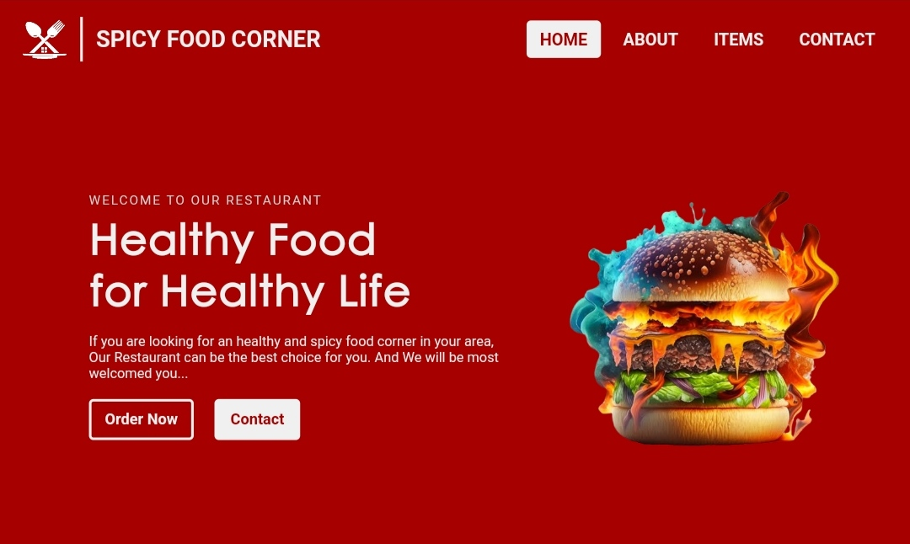
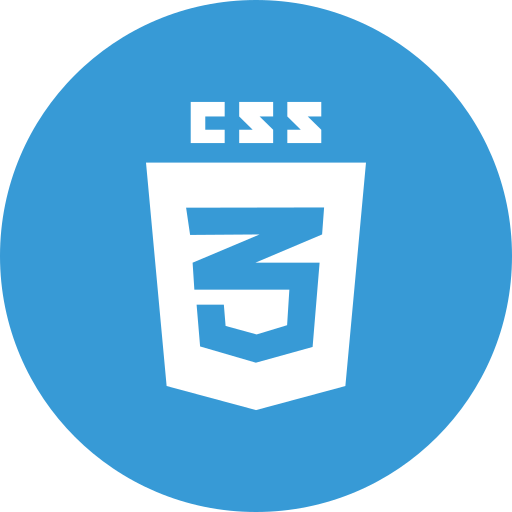

<!-- PROJECT INTRO -->

  

  <h1> Restaurant Website </h1>

  <h3> This is a restaurant website temaplate idea. </h3>
  

    <a href="https://abdullahab120.github.io/Restaurant-website"> View Demo </a>
    ·
    <a href="https://github.com/AbdullahAB120/Restaurant-website/issues/new?labels=bug&template=bug-report---.md"> Report Bug </a>
    ·
    <a href="https://github.com/AbdullahAB120/Restaurant-website/issues/new?labels=enhancement&template=feature-request---.md"> Request Feature </a>
  

 
 

<!-- ABOUT THE PROJECT -->
## About The Project

A simple responsive restaurant landing page built using HTML5 and CSS3. This project was created during the early stages of my web development journey to practice the fundamentals of HTML, CSS, and responsive design.

### Features:
• Built with HTML5 & CSS3
• Responsive Layout
• Simple & Clean UI
• Restaurant Landing Page
• Basic Navigation Menu
• Well-Structured HTML
• Mobile-Friendly Design

This beginner-level project helped me build a strong foundation in front-end development. It focuses on writing clean HTML, organizing CSS effectively, and creating a responsive layout that works across different screen sizes. While the design and functionality are simple, it reflects my early learning process and understanding of core web development concepts.

 
 

<!-- BUILT WITH -->
## Built With

 
 
 
 
 
 

 
 
<!-- CONTRIBUTING -->
## Contributing

Contributions are what make the open source community such an amazing place to learn, inspire, and create. Any contributions you make are **greatly appreciated**.

If you have a suggestion that would make this better, please fork the repo and create a pull request. You can also simply open an issue with the tag "enhancement".
Don't forget to give the project a star! Thanks again!

1. Fork the Project
2. Create your Feature Branch (`git checkout -b feature/AmazingFeature`)
3. Commit your Changes (`git commit -m 'Add some AmazingFeature'`)
4. Push to the Branch (`git push origin feature/AmazingFeature`)
5. Open a Pull Request

 
 

<!-- LICENSE -->
## License

Distributed under the MIT License. See `LICENSE.txt` for more information.

 
 

<!-- CONTACT -->
## Contact 

<a href="https://www.facebook.com/AbdullahAB120"> Facebook </a>
·
<a href="https://www.instagram.com/AbdullahAB_120"> Instagram </a>
·
<a href="https://www.linkedin.com/in/AbdullahAB120"> LinkedIn </a>
·
<a href="https://www.x.com/AbdullahAB120"> Twitter </a>
·
<a href="https://www.fiver.com/AbdullahAB120"> Fiverr </a>
